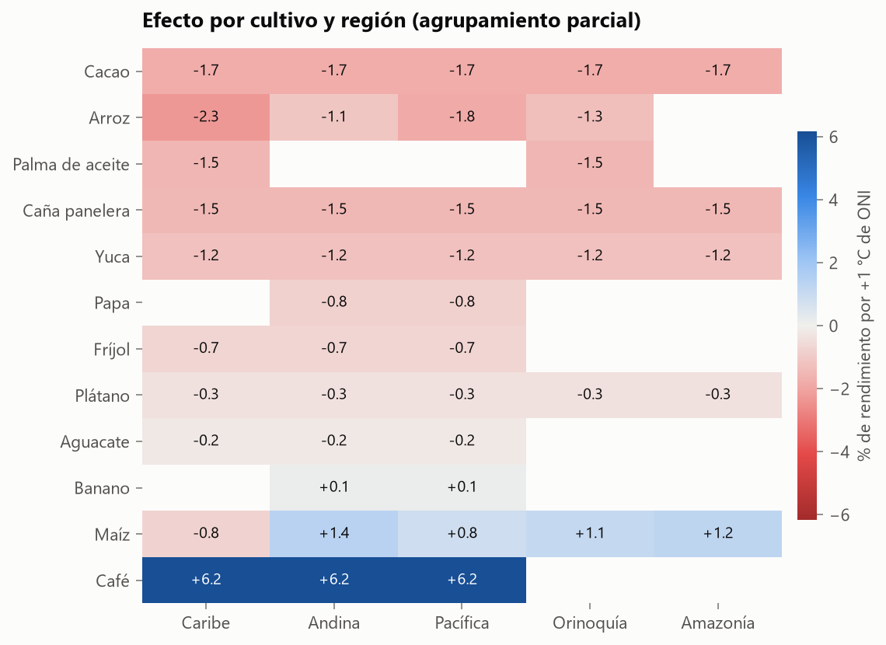

# El Niño, La Niña y los cultivos de Colombia

**¿Cuánto daño le hace El Niño a la agricultura colombiana, y se puede anticipar qué municipios tendrán una mala
cosecha con un año de antelación?**

Proyecto de ciencia de datos de punta a punta con datos públicos reales: ~98 000 registros
municipio-cultivo-año (2007–2025), 12 cultivos, más de 1 000 municipios, lluvia satelital, temperatura y el índice
oficial de El Niño.

[](#calidad-del-código)  

> **Dashboard:** `streamlit run app/streamlit_app.py` · **Informe ejecutivo:** [reports/informe_ejecutivo.md](reports/informe_ejecutivo.md) · **Informe técnico:** [reports/informe_tecnico.md](reports/informe_tecnico.md)



## Resultados en 30 segundos

| Pregunta | Respuesta |
|---|---|
| ¿El Niño reduce el rendimiento agrícola nacional? | **No de forma apreciable.** +0,0 % por °C de ONI, IC 95 % [−1,1 %; +1,8 %]. Un nulo *preciso* |
| ¿Hay cultivos ganadores y perdedores? | **Sí.** Pierden el arroz del Caribe (−2,3 %/°C), el cacao (−1,7 %) y la caña panelera (−1,5 %). Gana el café (+6,2 %), consistente con la cosecha récord de 2015–16 |
| ¿Por qué canal? | Sobre todo **temperatura**: cada +1 °C resta ~2 % a maíz, caña y papa y suma 4,6 % al café |
| ¿Qué tan confiables son los datos? | El 31 % de los rendimientos EVA repite exactamente el del año anterior y el 38 % son números enteros. Los efectos son una cota inferior |
| ¿Se puede anticipar una mala cosecha? | **Sí, para priorizar.** El 10 % de mayor riesgo concentra 3,3× la tasa base (52 % vs. 16 %); PR-AUC 0,38 [0,37; 0,40] vs. 0,16 del azar y 0,24 de la persistencia |
| ¿Hay fuga de información? | **No.** Con etiquetas permutadas, ROC-AUC = 0,49 y PR-AUC = tasa base |
| ¿Qué pasa en 2027 con El Niño de 2026 (ONI +2,1)? | ~229 mil ha esperadas con caída ≥ 20 %; El Niño aporta ~10 mil ha frente a un año neutral. Sube el riesgo de la palma de aceite y baja el del fríjol |

**El hallazgo metodológico central:** como el ONI es igual para todos los municipios en un año, hay ~19 observaciones
efectivas, no 100 000. El error estándar ingenuo es **6,2 veces** más pequeño que el correcto (bootstrap por años).
Con el ingenuo, casi cualquier cultivo parecería "significativamente" afectado.

**Una decisión que el pipeline toma solo:** la calibración isotónica se adopta únicamente si mejora el Brier del
backtest. No lo hizo, y se descartó. La regresión logística empata con LightGBM, y el informe lo dice tal cual.

## Qué demuestra este proyecto

| Habilidad | Dónde se ve |
|---|---|
| **Ingeniería de datos con fuentes reales y sucias** | Dos bases EVA con esquemas distintos armonizadas; coordenadas corruptas recuperadas; descarga reproducible y con caché de 5 APIs públicas ([`download.py`](src/agroclima/download.py), [`clean.py`](src/agroclima/clean.py)) |
| **Validación crítica de fuentes** | Se descartó la lluvia de NASA POWER al detectar que su correlación con El Niño cambiaba de signo entre décadas; se reemplazó por CHIRPS ([`climate.py`](src/agroclima/climate.py)) |
| **Auditoría de calidad del dato** | Quiebre metodológico de la EVA en 2019, un tercio de rendimientos "arrastrados", 40 % de valores enteros: medidos, corregidos o reportados como limitación |
| **Inferencia estadística honesta** | Bootstrap por años, pruebas de permutación, Benjamini-Hochberg, agrupamiento parcial (Bayes empírico), efectos fijos de año, 8 especificaciones de robustez ([`inference.py`](src/agroclima/inference.py)) |
| **Pensamiento causal** | ENSO como experimento natural; separación explícita entre *efecto* (inferencia) y *predicción* (pronóstico) |
| **Machine learning sin fugas** | Fecha de emisión fija, rezago de publicación de la EVA, validación con origen móvil, líneas base de climatología y persistencia, control negativo con etiquetas permutadas, calibración isotónica temporal ([`predict.py`](src/agroclima/predict.py)) |
| **Interpretabilidad** | TreeSHAP global y factores principales por municipio-cultivo |
| **Comunicación** | Dashboard interactivo con simulador de escenarios, informe ejecutivo de una página e informe técnico |
| **Ingeniería de software** | Paquete instalable, CLI, 40 tests (incluidos tests anti-fuga), ruff, CI en GitHub Actions |

## Arquitectura

```
datos.gov.co (EVA, DIVIPOLA) ─┐
IRI / UCSB (CHIRPS)          ─┤   download → clean → panel ─┬─→ inference ─→ efectos, robustez
NASA POWER (temperatura)     ─┤                             └─→ predict  ─→ backtest, modelo, pronóstico 2027
NOAA PSL (ONI)               ─┘                                    │
                                                                   └─→ report (figuras + informes) · app (Streamlit)
```

| Módulo | Responsabilidad |
|---|---|
| `config.py` | Todas las decisiones de análisis en un solo lugar (umbrales, ventanas, cultivos) |
| `download.py` | Descarga idempotente con reintentos y caché |
| `clean.py` | Armonización EVA 2007–2018 / 2019–2025, limpieza, atípicos |
| `enso.py` | ONI, episodios oficiales NOAA, ventanas de exposición |
| `climate.py` | Lluvia CHIRPS y temperatura POWER por municipio, anomalías vs. normal 1991–2020 |
| `panel.py` | Panel analítico, desestacionalización por serie con quiebre 2019 |
| `inference.py` | Efecto de ENSO y su incertidumbre |
| `predict.py` | Variables sin fuga, backtest, líneas base, calibración, SHAP |
| `pipeline.py` / `cli.py` | Orquestación reproducible |

## Cómo reproducirlo

Requiere Python 3.11+.

```bash
pip install -e ".[dev]"
```

```bash
agroclima all
```

```bash
streamlit run app/streamlit_app.py
```

`agroclima all` descarga ~200 MB de datos públicos (EVA, CHIRPS, POWER, ONI), reconstruye el panel, ejecuta la
inferencia y el pronóstico (~10 min) y regenera `data/processed/` y `reports/`. Cada etapa se puede correr por
separado: `agroclima build`, `agroclima inference`, `agroclima forecast`, `agroclima report`.

El dashboard solo necesita `data/processed/` (versionado en el repositorio, ~10 MB), así que se puede desplegar
en Streamlit Community Cloud sin descargar los datos crudos.

> **Windows:** si el proyecto está en una ruta muy larga, las extensiones compiladas de SciPy pueden fallar al
> cargar (límite de 260 caracteres). Cree el entorno virtual en una ruta corta.

## Calidad del código

```bash
pytest
```

```bash
ruff check src app tests
```

Los tests más importantes verifican que **el pronóstico no ve el futuro**: alteran los datos posteriores a la fecha
de emisión y comprueban que las variables no cambian ([`tests/test_predict.py`](tests/test_predict.py)).

## Fuentes de datos

- **EVA** – Evaluaciones Agropecuarias Municipales, Ministerio de Agricultura. datos.gov.co `2pnw-mmge` (2007–2018) y `uejq-wxrr` (2019–2025).
- **CHIRPS v2.0** – Funk et al. (2015), Climate Hazards Center, UCSB; vía IRI Data Library.
- **NASA POWER** – Prediction Of Worldwide Energy Resources, NASA Langley (MERRA-2).
- **ONI** – Oceanic Niño Index, NOAA CPC, distribuido por NOAA PSL.
- **DIVIPOLA** – centroides municipales, datos.gov.co `pqwj-3fi4`.

## Licencia

MIT. Los datos pertenecen a sus respectivas fuentes y se usan bajo sus licencias abiertas.
