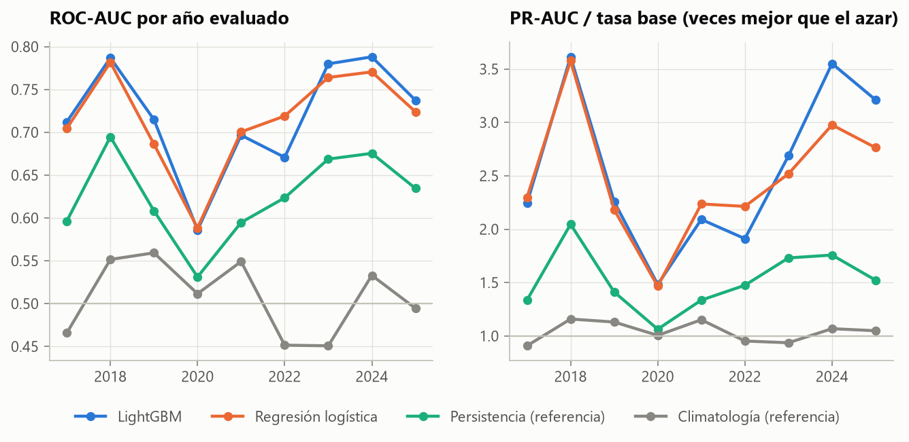
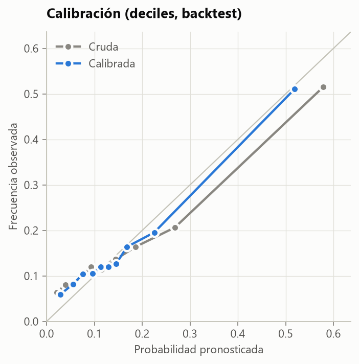
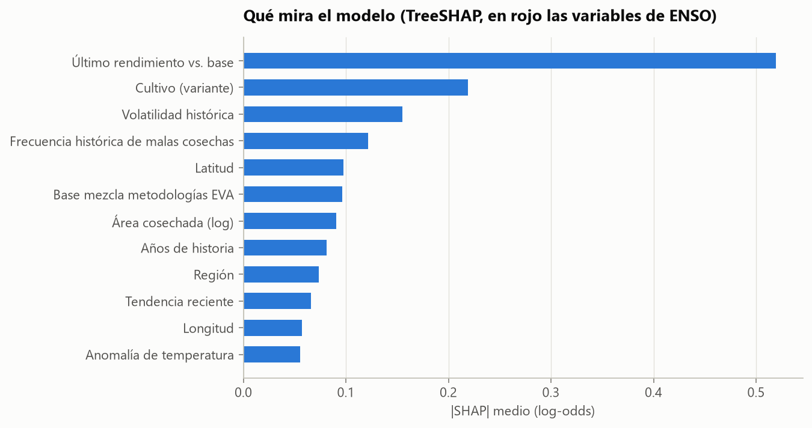
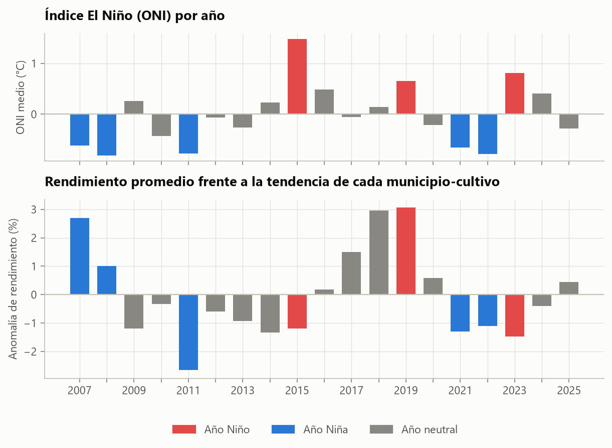
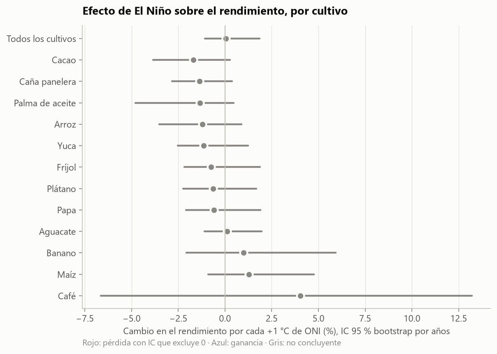
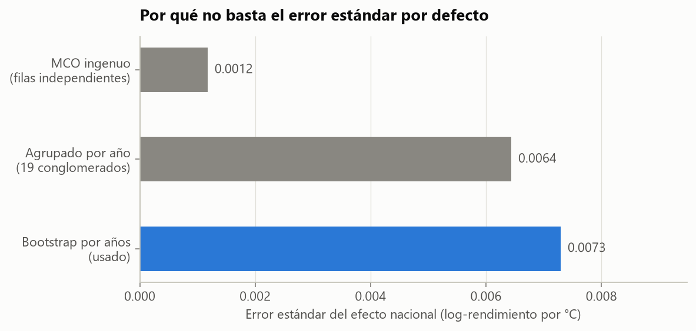
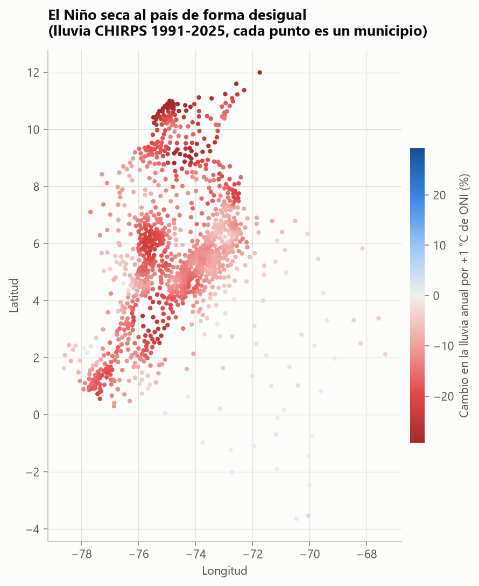
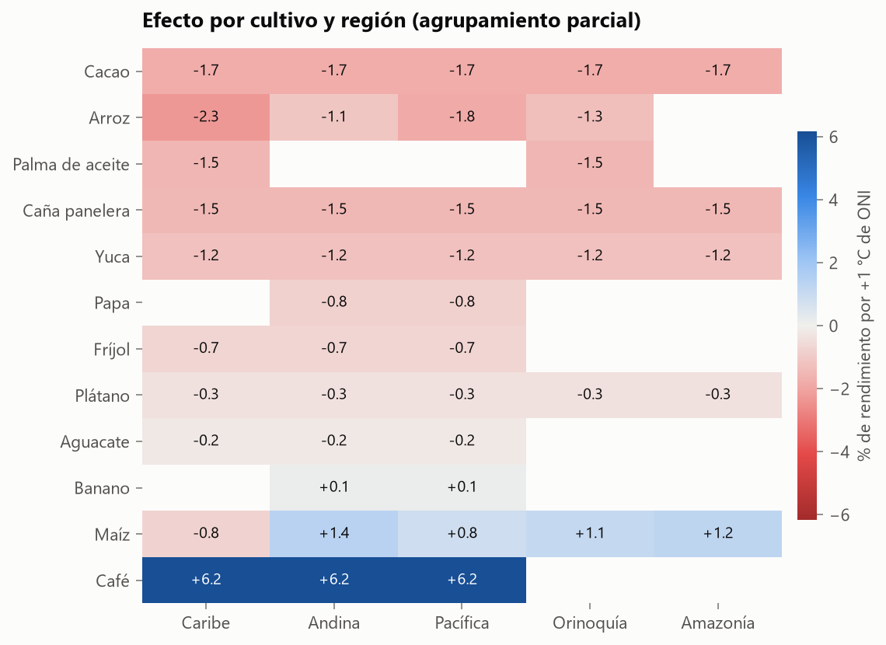
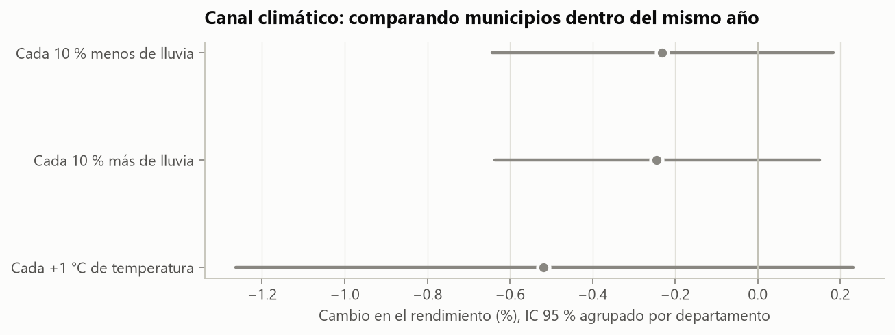
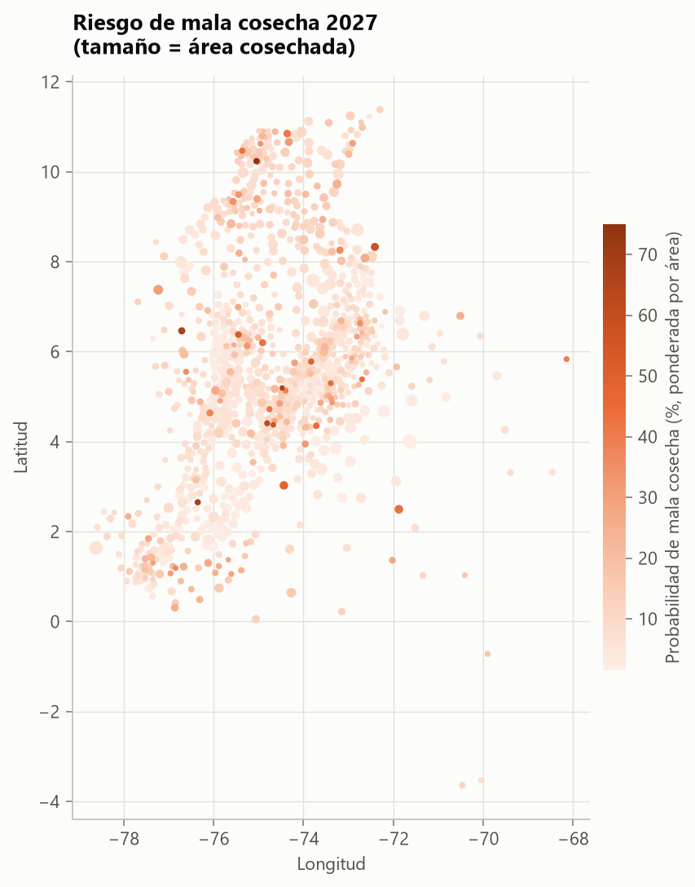

# Informe técnico

## 1. Datos y construcción del panel

| Fuente | Uso |
|---|---|
| EVA 2007–2018 (`2pnw-mmge`) y 2019–2025 (`uejq-wxrr`), datos.gov.co | Rendimiento municipal |
| CHIRPS v2.0 mensual (IRI Data Library) | Lluvia, ventana de ±0.1° en torno al centroide |
| NASA POWER mensual (MERRA-2) | Temperatura media y máxima |
| ONI (NOAA PSL) | Exposición a ENSO |
| DIVIPOLA (`pqwj-3fi4`) | Centroides municipales |

**Unidad de análisis:** serie = municipio × variante de cultivo; año agrícola = año calendario (semestres A y B
agregados: rendimiento = producción total / área cosechada total).

**Bitácora de limpieza**

| Etapa | Paso | Filas |
|---|---|---|
| registros EVA | registros originales | 372.800 |
| registros EVA | cultivo fuera del alcance del estudio | 192.890 |
| registros EVA | año fuera de 2007-2025 | 2.093 |
| registros EVA | área o producción faltante | 0 |
| registros EVA | área o producción en cero (sin cosecha) | 4.796 |
| registros EVA | área cosechada mayor que la sembrada | 8.888 |
| panel anual | municipio-cultivo-año agregados | 122.585 |
| panel anual | rendimiento atípico (> 5 MAD de su serie) | 2.859 |
| panel anual | área cosechada < 10 ha | 12.371 |
| panel anual | series con menos de 8 años | 6.323 |
| panel anual | panel final | 101.032 |

**Hallazgos de calidad de datos**

- *Quiebre metodológico 2019.* Las dos bases EVA no son continuas: sin corrección, la anomalía media salta en
  2019. La tendencia de cada serie admite un salto de nivel en 2019.
- *Datos arrastrados.* 30.7% de los registros repiten exactamente el rendimiento del año
  anterior. Por cultivo: Café 5%, Fríjol 17%, Arroz 18%, Maíz 21%, Papa 31%, Cacao 39%, Palma de aceite 40%, Aguacate 41%, Yuca 44%, Caña panelera 45%, Banano 45%, Plátano 47%.
- *Coordenadas corruptas.* La DIVIPOLA publicada contiene un municipio con latitud `525` y longitud
  `-74916666.875`; se recupera el punto decimal solo si el resultado cae dentro de Colombia.
- *Lluvia reanalizada inconsistente.* La lluvia de NASA POWER tiene correlación con el ONI de −0,78 (1991–2000) pero
  +0,19 (2001–2010); con CHIRPS la correlación nacional es estable (≈ −0,8 en todas las décadas). Se usa CHIRPS.
  En el 99% de los municipios la lluvia anual cae cuando sube el ONI.

## 2. Inferencia del efecto

**Resultado:** anomalía de log-rendimiento = residuo de la regresión de log(rendimiento) sobre intercepto,
tendencia lineal y salto 2019, estimada por separado para cada serie. Absorbe diferencias permanentes (suelo,
altitud, tecnología) y mejoras graduales.

**Estimador:** pendiente MCO de la anomalía sobre el ONI medio enero–diciembre.

**Inferencia:** el ONI es común a todos los municipios en un año, así que el número efectivo de observaciones
para el efecto es ~19 años, no 101.032 filas.

| Método | Error estándar |
|---|---|
| MCO ingenuo | 0.0012 |
| Agrupado por año (19 conglomerados) | 0.0064 |
| **Bootstrap por años (usado)** | **0.0073** |

El error ingenuo es 6.2 veces demasiado pequeño. Los p-valores se
obtienen permutando el ONI entre años (4.000 permutaciones), exacto bajo la hipótesis nula. Con 12 cultivos se
reportan además q-valores de Benjamini-Hochberg.

| Grupo | Efecto por +1 °C ONI | IC 95 % | p (perm.) | q (B-H) | Obs. |
|---|---|---|---|---|---|
| Todos los cultivos | +0,0 % | [-1,1 %; +1,8 %] | 0.947 |  | 101.032 |
| Aguacate | +0,1 % | [-1,1 %; +2,0 %] | 0.878 | 0.88 | 5.333 |
| Arroz | -1,2 % | [-3,5 %; +0,9 %] | 0.230 | 0.60 | 5.601 |
| Banano | +1,0 % | [-2,1 %; +5,9 %] | 0.548 | 0.60 | 2.874 |
| Cacao | -1,7 % | [-3,9 %; +0,3 %] | 0.216 | 0.60 | 8.022 |
| Café | +4,0 % | [-6,6 %; +13,2 %] | 0.365 | 0.60 | 11.012 |
| Caña panelera | -1,4 % | [-2,8 %; +0,4 %] | 0.060 | 0.60 | 7.531 |
| Fríjol | -0,7 % | [-2,2 %; +1,9 %] | 0.423 | 0.60 | 9.741 |
| Maíz | +1,3 % | [-0,9 %; +4,8 %] | 0.381 | 0.60 | 18.678 |
| Palma de aceite | -1,3 % | [-4,8 %; +0,5 %] | 0.320 | 0.60 | 1.986 |
| Papa | -0,6 % | [-2,1 %; +1,9 %] | 0.507 | 0.60 | 5.428 |
| Plátano | -0,6 % | [-2,2 %; +1,7 %] | 0.520 | 0.60 | 13.355 |
| Yuca | -1,2 % | [-2,5 %; +1,2 %] | 0.140 | 0.60 | 11.471 |

**Heterogeneidad cultivo × región:** pendiente y error bootstrap por celda, contraídos hacia la media del cultivo
con Bayes empírico (DerSimonian-Laird), equivalente a pendientes aleatorias de un modelo mixto pero con errores que
respetan la correlación entre municipios del mismo año.

**Canal climático:** regresión de la anomalía sobre déficit de lluvia, exceso de lluvia y anomalía de temperatura
con **efectos fijos de año** (identifica con variación entre municipios dentro del mismo año), errores agrupados
por departamento.

**Robustez del efecto nacional**

| Especificación | Efecto | IC 95 % | p |
|---|---|---|---|
| Principal: tendencia por serie + quiebre 2019 | +0,0 % | [-1,1 %; +1,8 %] | 0.95 |
| Sin quiebre metodológico 2019 | -2,1 % | [-5,2 %; +1,9 %] | 0.22 |
| ONI julio(t-1)-junio(t) | +0,5 % | [-0,3 %; +1,8 %] | 0.30 |
| Ponderado por área cosechada | +0,7 % | [-1,6 %; +3,2 %] | 0.54 |
| Solo series con 15+ años | +0,1 % | [-1,2 %; +2,0 %] | 0.88 |
| Excluyendo 2018 (cobertura parcial) | -0,0 % | [-1,1 %; +1,6 %] | 0.96 |
| Solo series con < 25 % de datos repetidos | +1,1 % | [-2,1 %; +4,6 %] | 0.47 |
| Solo base 2007-2018 | -0,4 % | [-1,9 %; +2,0 %] | 0.62 |

## 3. Pronóstico de malas cosechas

- **Objetivo:** rendimiento en *t* ≥ 20% por debajo de la mediana de *t−2 … t−6*.
- **Emisión:** 1 de octubre de *t−1*. Rendimientos hasta *t−2* (rezago de publicación de la EVA), ONI de
  julio a septiembre de *t−1* y su tendencia, y clima de enero a septiembre de *t−1*.
- **Variables:** cultivo, región, ubicación y elevación, ENSO, anomalías climáticas, historia productiva
  (desvío del último dato, volatilidad, tendencia, frecuencia histórica de malas cosechas, fracción de datos
  repetidos, área).
- **Validación:** origen móvil; para el año *T* se entrena con años objetivo ≤ *T−2*. Referencias: climatología
  por cultivo y regresión logística.
- **Modelo:** LightGBM (hiperparámetros fijados a priori, sin optimizar sobre el backtest).

| Modelo | ROC-AUC | PR-AUC [IC 95 %] | Brier | Brier skill | Precisión 10 % alertas | Precisión 20 % alertas |
|---|---|---|---|---|---|---|
| Climatología (referencia) | 0.503 | 0.158 [0.151; 0.165] | 0.1344 | +0.000 | 14.2% | 15.9% |
| Persistencia (referencia) | 0.593 | 0.235 [0.226; 0.244] | 0.1266 | +0.058 | 32.3% | 31.6% |
| Regresión logística | 0.708 | 0.381 [0.365; 0.396] | 0.1186 | +0.118 | 49.3% | 36.6% |
| LightGBM | 0.708 | 0.380 [0.366; 0.396] | 0.1181 | +0.121 | 51.5% | 36.1% |
| LightGBM calibrado | 0.700 | 0.367 [0.355; 0.382] | 0.1186 | +0.117 | 51.0% | 35.4% |

IC 95 % por bootstrap agrupado por municipio (las series de un municipio comparten clima y encuestador). La tasa
base (15.9%) es el piso del PR-AUC. No se reporta exactitud: un modelo que nunca
alerta tendría 84% de exactitud y no detectaría ningún caso.

**Lectura honesta.** La persistencia ("si la última cosecha conocida fue mala, esta también") es la referencia
más exigente en paneles; LightGBM la supera. Una regresión logística de cinco variables queda cerca de LightGBM:
la señal está en la historia productiva (desvío reciente, volatilidad), no en interacciones complejas.

**Controles negativos.** Se repitió el backtest completo con etiquetas permutadas:

| Permutación | ROC-AUC | PR-AUC | Tasa base |
|---|---|---|---|
| Dentro de cada año | 0.494 | 0.158 | 0.159 |
| Dentro de cada municipio-año | 0.568 | 0.195 | 0.159 |

Con la permutación por año el desempeño cae al azar: no hay fugas. La permutación dentro de municipio-año
conserva la prevalencia local, de modo que el clima y la ubicación todavía pueden predecirla; la diferencia entre
esa fila y el modelo real (0.708) es la señal que aporta la historia de cada serie.

**Calibración.** Isotónica, aprendida para cada año solo con predicciones de backtest de años ≤ T−2. Se adopta solo
si mejora el Brier del backtest; modelo usado para el pronóstico: **LightGBM**.

**Extrapolación.** El ONI de julio a septiembre de 2026 (+2.13 °C) supera el máximo del
entrenamiento (+1.73 °C, emitido en 2015 para 2016). Un modelo de árboles no
extrapola: trata el evento actual como el más fuerte que conoce, de modo que el riesgo de 2027 podría estar subestimado.

## 4. Limitaciones

- La EVA es una estimación por consenso; los datos arrastrados atenúan los efectos (sesgo hacia cero).
- 38% de los rendimientos son números enteros (apilamiento de dígitos): parte de la
  variación año a año es ruido de redondeo, irreducible para cualquier modelo.
- Las anomalías climáticas usan la normal 1991–2020, publicada en 2021; los pronósticos simulados anteriores a
  2021 la usan igualmente. Su efecto sobre una anomalía de nueve meses es despreciable frente al ruido de la EVA.
- El filtro de errores de digitación usa la mediana de toda la serie, pero solo actúa sobre desvíos de ×3 o más,
  de modo que no borra malas cosechas reales.
- Solo 19 años de variación de ENSO; los contrastes por fase (3 años Niño, 5 Niña) son imprecisos.
- Se mide rendimiento, no producción: El Niño también puede reducir el área sembrada.
- Clima en el centroide municipal; los municipios montañosos tienen gradientes internos fuertes.
- La interpretación causal requiere que, condicionado a la tendencia de cada serie, nada que varíe año a año y se
  correlacione con el ONI afecte el rendimiento por otras vías (p. ej., precios internacionales correlacionados con ENSO).

## Figuras

